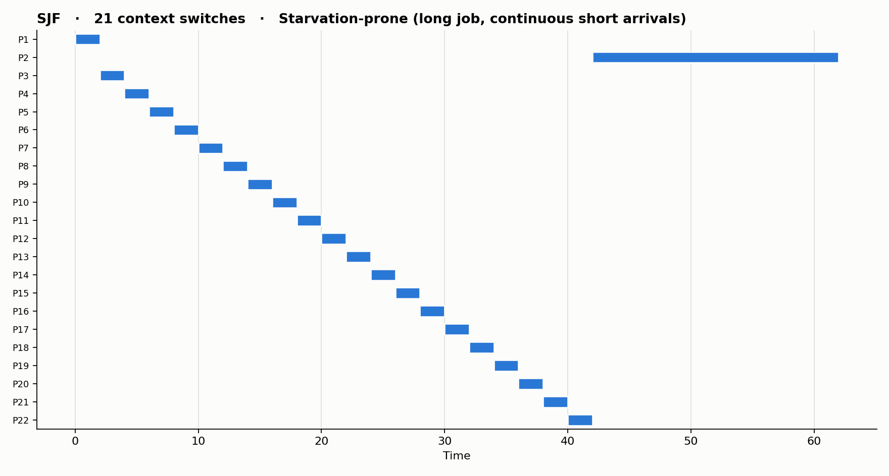
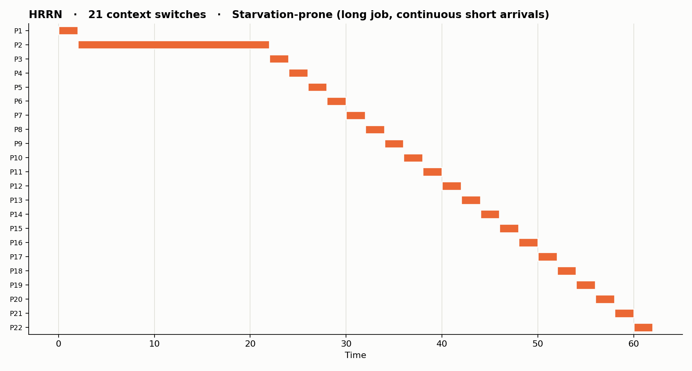
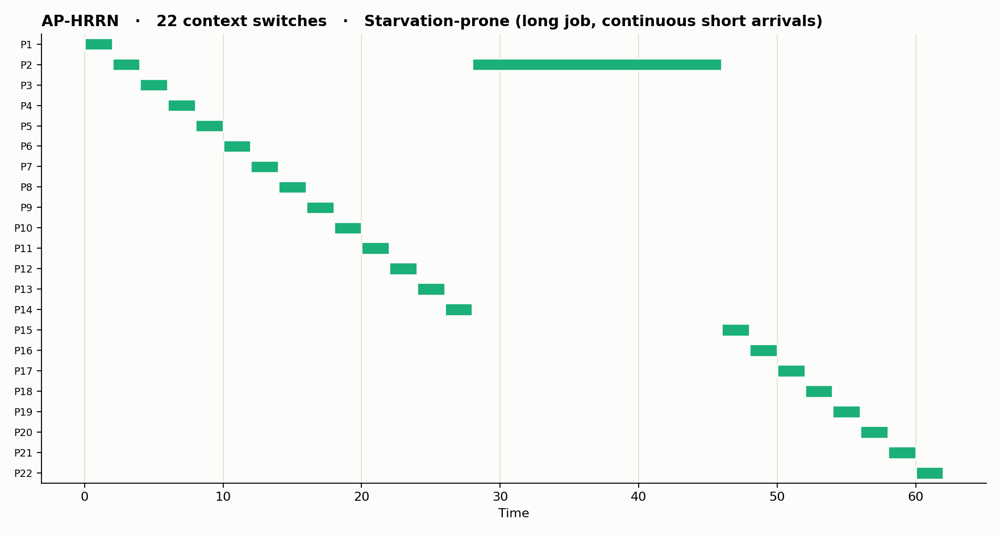

# ⚙️ AP-HRRN: A Fairer CPU Scheduler

**One question:** when many programs are waiting, which one should the CPU run next?

We compared two classic answers, **SJF** and **HRRN**, found where they fail, and built our own: **AP-HRRN** (*Aging Preemptive HRRN*). It's all a Python simulation, so you can run it and see.

  

---

## ⚡ The 20-second version

| | 🏃 SJF | 🕰️ HRRN | 🚀 AP-HRRN (ours) |
|---|---|---|---|
| **Idea** | Shortest job first | Longer wait = higher priority | Both ideas + preemption |
| **Strength** | Lowest average wait | Fair | Fair **and** quick to respond |
| **Weakness** | Long jobs can starve | Short jobs get stuck behind a long one | A few extra context switches |


<details>
<summary><b>🔍 How the score works (click)</b></summary>

```
score = (waited + est_remaining) / est_remaining + boost × floor(waited / L)
```

- **Short remaining time** → higher score (SJF-like)
- **Long waiting** → higher score (HRRN-like)
- **`k`**: stops the CPU flip-flopping over tiny differences
- **`L`**: once a process has waited this long, it can't be bumped again (the anti-starvation guard)
- **Burst estimate:** exact, or predicted with `tau_new = alpha × last_burst + (1 − alpha) × tau_old`

Defaults: `alpha=0.5` · `tau0=6` · `k=1.5` · `L=24` · `boost=10`
</details>

---

## 📁 Project structure

```
AP-HRRN-CPU-Scheduler/
└── cpu_scheduling/
    ├── cpu_scheduling/        # Python backend
    │   ├── scheduler.py       # SJF, HRRN and AP-HRRN algorithms
    │   ├── process.py         # Process model, metrics, test cases
    │   ├── compare.py         # Comparison tables + graphs
    │   ├── tuning.py          # Parameter sweeps
    │   ├── api.py             # Flask API used by the web app
    │   ├── graphs/            # Generated charts (PNG)
    │   ├── results/           # Generated CSV results
    │   └── tests/             # pytest tests
    └── frontend/              # React + Vite web app
```

---

## 🚀 Try it in 1 minute

```bash
git clone https://github.com/JaineshBharti5/AP-HRRN-CPU-Scheduler.git
cd AP-HRRN-CPU-Scheduler/cpu_scheduling/cpu_scheduling
pip install matplotlib pytest flask
```

| Run this | You get |
|---|---|
| `python scheduler.py` | Demo with Gantt charts in your terminal |
| `python compare.py` | Comparison tables + graphs |
| `python tuning.py` | Parameter sweeps |
| `python -m pytest tests` | 13 tests |
| `python api.py` | Backend API for the web app (http://127.0.0.1:5000) |

**Or plug in your own processes:**

```python
from process import Process, compute_metrics
from scheduler import ALGORITHMS

jobs = [Process(1, 0, 8), Process(2, 1, 7), Process(3, 2, 2)]  # (id, arrival, burst)
for name, algo in ALGORITHMS.items():
    procs, timeline = algo(jobs)
    print(name, compute_metrics(procs, timeline))
```

---

## 🖥️ Web app (React + Flask)

An interactive UI to run all three schedulers and compare them visually.

**Terminal 1: backend** (http://127.0.0.1:5000)

```bash
cd cpu_scheduling/cpu_scheduling
pip install flask matplotlib
python api.py
```

**Terminal 2: frontend** (http://localhost:5173)

```bash
cd cpu_scheduling/frontend
npm install
npm run dev
```

Open http://localhost:5173. The dev server forwards `/api` calls to the Flask backend, so start the backend first.

**What you can do in the UI**

- Enter processes by hand (PID, arrival, burst) and add or remove rows
- Load built-in examples: phase 1, mixed, starvation, many short jobs, idle gap, single process, simultaneous arrival
- Generate random workloads (count, max arrival, max burst, optional seed)
- Tune AP-HRRN: `k`, wait limit, boost, `alpha`, `tau0`, and the burst estimator (exact or predicted)
- See results as a metrics table, 6 metric bar charts, a waiting-time-per-process chart, a Gantt chart per algorithm, and per-process tables (start, completion, turnaround, waiting, response)
- Run a random benchmark averaged over many workloads

---

## 📊 Results

Tested on 3 hand-made scenarios + 40 random workloads (fixed seeds, so results repeat exactly).

### 🏆 Where AP-HRRN wins

| Test | SJF | HRRN | AP-HRRN |
|---|---|---|---|
| Worst-case wait (random avg) | 85.08 | 78.20 | **75.90** ✅ |
| Avg wait, starvation case | 10.50 | 26.86 | **18.14** ✅ vs HRRN |
| Avg wait, many short jobs | 2.00 | 8.19 | **5.56** ✅ vs HRRN |
| Avg response, many short jobs | 2.00 | 8.19 | **4.62** ✅ vs HRRN |

<details>
<summary><b>👀 Example: 5 processes (click)</b></summary>

P1 (arrives 0, burst 8) · P2 (1, 7) · P3 (2, 2) · P4 (9, 1) · P5 (10, 1)

| Algorithm | Avg wait | Avg response | Max wait | Context switches |
|---|---|---|---|---|
| SJF | 3.80 | 3.80 | 11 | 4 |
| HRRN | 6.20 | 6.20 | 9 | 4 |
| **AP-HRRN** | 4.40 | **2.20** | 11 | 5 |

AP-HRRN lets short P3 jump in early, so response is best.
</details>

<details>
<summary><b>🧪 Full results table (click)</b></summary>

| Scenario | Algorithm | Avg wait | Avg turnaround | Avg response | Max wait | Switches |
|---|---|---|---|---|---|---|
| Mixed | SJF | 11.90 | 18.10 | 11.90 | 47 | 9 |
| Mixed | HRRN | 13.60 | 19.80 | 13.60 | 47 | 9 |
| Mixed | AP-HRRN | 15.50 | 21.70 | 15.50 | 44 | 9 |
| Starvation | SJF | 10.50 | 13.32 | 10.50 | 41 | 21 |
| Starvation | HRRN | 26.86 | 29.68 | 26.86 | 39 | 21 |
| Starvation | AP-HRRN | 18.14 | 20.95 | 17.05 | 39 | 22 |
| Many short | SJF | 2.00 | 4.62 | 2.00 | 27 | 15 |
| Many short | HRRN | 8.19 | 10.81 | 8.19 | 16 | 15 |
| Many short | AP-HRRN | 5.56 | 8.19 | 4.62 | 18 | 17 |
| Random (avg of 40) | SJF | 26.31 | 34.34 | 26.31 | 85.08 | 14.00 |
| Random (avg of 40) | HRRN | 28.83 | 36.85 | 28.83 | 78.20 | 14.00 |
| Random (avg of 40) | AP-HRRN | 31.22 | 39.25 | 30.70 | 75.90 | 14.78 |

CPU utilization is ~100% for all three, so nobody wastes CPU time.
</details>

<details>
<summary><b>📈 Gantt charts: starvation case (click)</b></summary>

Long job P2 (burst 20) with a steady stream of short jobs. A process split into several blocks was preempted.

**SJF:** long job waits till the very end


**HRRN**


**AP-HRRN**

</details>

<details>
<summary><b>🎛️ What do the knobs do? (click)</b></summary>

| Knob | Effect |
|---|---|
| **`k` ↑** | Fewer context switches (15.68 → 14.07), waiting barely rises |
| **`L` ↓** | Protects long jobs sooner, but average wait goes up. Turning aging off brings max wait back up to HRRN's level |
| **`boost` ↑** | Stops helping after ~10 |
| **`alpha`** | Barely matters; loss comes from burst estimation error |
</details>

> 💬 **Honest summary:** SJF still has the lowest *average* wait. AP-HRRN trades a little average speed for **fairness and a lower worst-case wait**. It's not a free win, and we don't claim it is.

---

## ⚠️ Limitations

- [x] Main tests use **exact burst times** (the ideal case). With estimated bursts, AP-HRRN does worse.
- [x] Context switches are **counted but cost no time**.
- [x] Only 3 scenarios + 40 random sets, with no I/O-heavy workloads.
- [x] Parameters were tuned on the same random set we report, so numbers may be a bit optimistic.

---

## 👥 Team: Operating Systems, Group 11

| Name | Reg. No. |
|---|---|
| Aryanish Singh Rathore | AP24110011056 |
| Bhumi Sengar | AP24110010346 |
| Surya Kanta Patra | AP24110011071 |
| Subhanshu Singh | AP24110011104 |
| Jainesh Bharti | AP24110010515 |

SRM University AP
